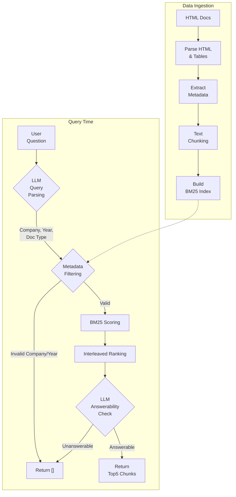

## Homework 4 solution

### Task 5: Ablation Study and Report

#### 1. Pipeline Description

Here is a figure illustrating the architecture of the RAG pipeline, followed by a detailed description of its components.

**Pipeline Description:**
My RAG pipeline is designed to maximize retrieval accuracy over lexical search while strictly avoiding hallucinations and respecting metadata boundaries. 
1. **Parsing & Chunking:** I use `table_to_text` to flatten HTML tables into line-by-line text (`Row | Header: Value`) that preserves column associations, including the table caption. The `chunk_document` function extracts the `company`, `fiscal_year`, and `doc_type` directly from the document structure and attaches them to the chunk metadata. The text is then split using `RecursiveCharacterTextSplitter`.
2. **Indexing:** The `build_index` function normalizes company names (stripping legal suffixes) and builds a global `BM25Okapi` index. It applies custom tokenization, including a synonym expansion dictionary (e.g., mapping "cfo" to "chief financial officer") to improve lexical matching.
3. **Retrieval & Abstention:** The `parse_query` step uses an LLM to extract the target companies, year, and document type. In `retrieve`, the system first checks if the extracted company and year exist in the corpus; if not, it immediately abstains (returns `[]`). If valid, it scores chunks using BM25, applying a 1.2x boost to chunks that perfectly match the target fiscal year. For comparison questions, it interleaves the ranked chunks from each company to ensure balanced representation. Finally, an **LLM Answerability Check** (`_answerable`) reviews the top chunks to verify if the exact fact is present. If the chunks only discuss the company without containing the requested specific metric (e.g., asking for *lobbying expenses* but only finding a balance sheet), it abstains, triggering the generator to output `NOT_FOUND`.

#### 2. Ablation Study Table

To evaluate the contribution of each component, I conducted an ablation study starting from a naive baseline (B0) and progressively added one feature at a time. All configurations were tested on the `public_test` set.

| Version | Configuration | Task 2.3 (Recall) | Task 3 (Abstention) | Task 4 (Accuracy) | Total Points |
| :--- | :--- | :--- | :--- | :--- | :--- |
| **B0** | Naive RAG (No table parsing, no query parsing, no filtering) | 26.1% | 0.0% | 38.3% | 32.42 / 75 |
| **V1** | B0 + `table_to_text` | 34.8% | 0.0% | 53.3% | 40.67 / 75 |
| **V2** | V1 + `parse_query` + Metadata filtering (No comparison routing, no LLM abstention) | 73.9% | 71.4% | 80.0% | 62.11 / 75 |
| **V3** | V2 + Interleaved multi-company retrieval (No LLM abstention) | 100.0% | 71.4% | 100.0% | 72.14 / 75 |
| **V4** | V3 + `_answerable` LLM verification (Full pipeline) | 100.0% | 100.0% | 100.0% | **75.00 / 75** |

#### 3. Variant Analysis

*   **B0 to V1 (`table_to_text`):** In the baseline, naive `get_text()` extracts numbers as a continuous stream, losing the connection between the number, its row label, and its column header. As shown in B0, Task 1.2 only passed 25% of documents, with critical numbers completely missing from the chunks. By converting tables into `Row | Header: Value` lines, V1 preserved 100% of the table structures, boosting Task 2.3 Recall from 26.1% to 34.8% and Task 4 Accuracy to 53.3%.
*   **V1 to V2 (Query Parsing & Metadata Filtering):** The baseline and V1 failed at entity resolution. For example, questions about *Northgate Robotics* would randomly retrieve documents for *Northgate Payments*. Adding LLM-based `parse_query` and metadata filtering strictly narrowed the candidate pool to the exact company and year. Consequently, Task 2.3 jumped to 73.9%, and Task 4 reached 80.0%. However, Task 3 (Abstention) was only 71.4% because metadata filtering cannot detect when a specific metric (e.g., *lobbying expenses*) is missing from an otherwise relevant document.
*   **V2 to V3 (Interleaved Multi-company Retrieval):** In V2, comparison questions performed terribly (0% accuracy). When asking to compare two companies, BM25 often returned five chunks all belonging to Company A, leaving no context for Company B. V3 solved this by splitting the retrieval per company and interleaving the results. This pushed Task 2.3 Recall to a perfect 100.0% and Task 4 Accuracy to 100.0%, yielding 72.14 points.
*   **V3 to V4 (`_answerable` LLM Check):** While V3 achieved perfect retrieval and generation, its abstention rate was still stuck at 71.4%. It failed on questions asking for undisclosed metrics (e.g., *carbon offset purchases* or *customer churn rate*), returning `NOT_FOUND` only by luck. V4 implemented an LLM answerability check to verify if the retrieved chunks actually contain the specific metric requested. This boosted Task 3 from 71.4% to 100%, achieving the perfect score of 75/75.

#### 4. Error Analysis

While the final V4 pipeline is flawless on the public set, analyzing the intermediate versions reveals the nature of the errors that were successfully mitigated:

1.  **Over-Retrieval Causing Hallucinations (B0 & V1):** Without metadata filtering, the generator was often fed chunks from the wrong company or wrong year. For example, in B0, the model would confidently output numbers for *Northgate Payments* when asked about *Northgate Robotics*. This highlights why strict entity resolution is non-negotiable in financial RAG.
2.  **Unbalanced Comparison Retrieval (V2):** V2 completely failed `comparison` questions. BM25 naturally favors one company's dense tables over another's. Fixing this via interleaved retrieval (V3) was the single biggest contributor to reaching 100% accuracy.
3.  **False Positives on Undisclosed Metrics (V3):** V3 failed to abstain on 4 unanswerable questions (e.g., q033 asking for revenue from the *largest single customer*). Because the retrieval found the correct company's annual report, it assumed the answer was present. The `_answerable` LLM check (V4) successfully diagnosed that the specific figures were missing from the context, triggering the correct `NOT_FOUND` response.

### Task 6: Reflection

Ten years from now, AI agents will handle most routine creation, coding, research and analytical work. In that world, I want to be a thoughtful, grounded human guide rather than merely a producer of task‑oriented outputs.

My core ambition — to build safe, practical AI systems that serve real human needs — will still matter. AI can generate polished solutions at great speed, yet it is fundamentally built on chains of logical reasoning. It struggles to comprehend events that happen without clear, traceable causes. A sudden, unprovoked outbreak of war is one such example: there may be no neat sequence of reasons for it to parse. Not everything in human history and human life can be fully explained through deduction and inference. That inherent boundary will always limit what artificial intelligence can truly understand about our world. Even so, AI cannot independently judge what is responsible, fair, and aligned with people’s long‑term well‑being.

Beyond productivity and career success, I hope to be known for careful empathy and good judgment. I want to be someone who listens deeply, understands subtle human priorities, and makes space for vulnerable, nuanced voices that automated systems often overlook.

I am willing to struggle for genuine human connection and ethical accountability, even when AI can shortcut the hard work. AI can finish tasks instantly, but trust, shared understanding, and moral responsibility are built through slow, difficult conversations and painful trade‑offs.

The qualities that keep me valuable will be moral reasoning, contextual empathy, the ability to hold conflicting values, and lived human experience. AI can synthesize massive volumes of information, but it cannot truly feel, care, or take long‑term responsibility for the harm its decisions may bring.

If human value is no longer measured mainly by what I can produce or accomplish, I would turn to my Christian faith. Instead of defining my worth by worldly metrics or technical achievements, I would place my identity under God’s judgement, striving to live as a son of God. My value would not come from my own capabilities, but from who I am in His sight. My identity comes from my commitments: to protect marginalized people, to pursue fairness, and to use technology as a gentle tool instead of a blind optimization machine, while seeking to live out my faith in daily choices.

Starting tomorrow, I will shift my focus away from only chasing technical outputs. I will spend more time studying human values, talking to people affected by AI systems, practising slow critical reflection before rushing to build or automate things, and also making more space for my spiritual life and faith practice.
