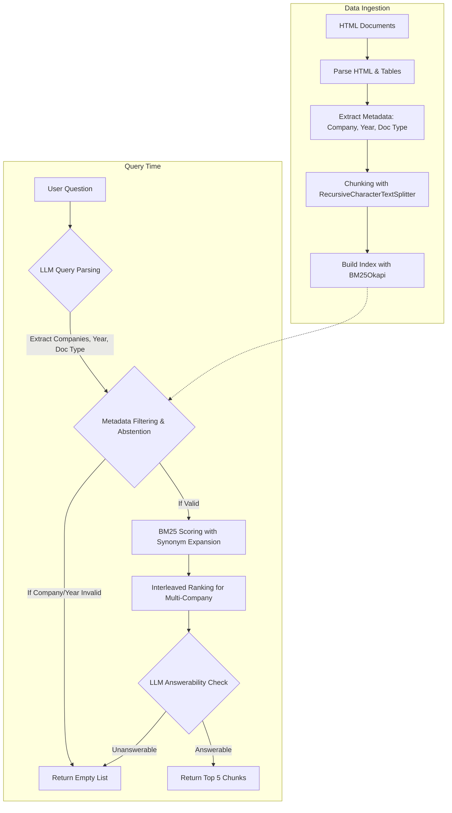

## Homework 4 solution

### Task 5: Ablation Study and Report

#### 1. Pipeline Description

Here is a figure illustrating the architecture of the RAG pipeline, followed by a detailed description of its components.

**Pipeline Description:**
My RAG pipeline is designed to maximize retrieval accuracy over lexical search while strictly avoiding hallucinations and respecting metadata boundaries. 
1. **Parsing & Chunking:** I use `table_to_text` to flatten HTML tables into line-by-line text (`Row | Header: Value`) that preserves column associations, including the table caption. The `chunk_document` function extracts the `company`, `fiscal_year`, and `doc_type` directly from the document structure and attaches them to the chunk metadata. The text is then split using `RecursiveCharacterTextSplitter`.
2. **Indexing:** The `build_index` function normalizes company names (stripping legal suffixes) and builds a global `BM25Okapi` index. It applies custom tokenization, including a synonym expansion dictionary (e.g., mapping "cfo" to "chief financial officer") to improve lexical matching.
3. **Retrieval & Abstention:** The `parse_query` step uses an LLM to extract the target companies, year, and document type. In `retrieve`, the system first checks if the extracted company and year exist in the corpus; if not, it immediately abstains (returns `[]`). If valid, it scores chunks using BM25, applying a 1.2x boost to chunks that perfectly match the target fiscal year. For comparison questions, it interleaves the ranked chunks from each company to ensure balanced representation. Finally, an **LLM Answerability Check** (`_answerable`) reviews the top chunks to verify if the exact fact is present. If the chunks only discuss the company without containing the requested specific metric (e.g., asking for *lobbying expenses* but only finding a balance sheet), it abstains, triggering the generator to output `NOT_FOUND`.
